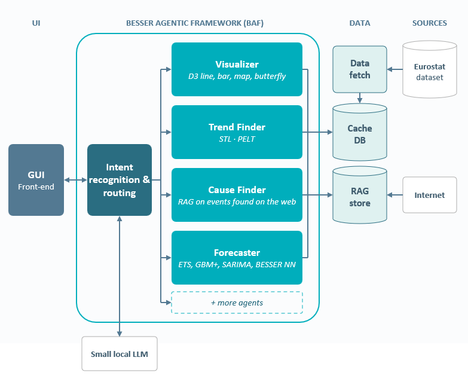

# Trade-Lens: Luxembourg's trade in goods, explained

Trade-Lens (the Luxembourg Trade Explorer) is a web app for Luxembourg's external trade in goods. You say
who you are, ask a question in plain words, and a team of four agents answers on the page with charts and
short notes. Every figure is calculated by fixed, documented methods from Eurostat's official trade data.

**Explore the platform:** [trade-lens.besser-pearl.org](https://trade-lens.besser-pearl.org/) No installation required.

Submission of team **BESSER** ([Luxembourg Institute of Science and Technology](https://www.list.lu)) to the
STATEC Hackathon 2026, GovTech Lab Luxembourg, 14 to 16 October 2026.

- **Live:** https://trade-lens.besser-pearl.org
- **Data:** Eurostat Comext, dataset [DS-045409, "EU trade since 1988 by HS2-4-6 and CN8"](https://ec.europa.eu/eurostat/databrowser/view/ds-045409/legacyMultiFreq/table?category=ext_go.ext_go_detail),
  which includes the data STATEC produces for Luxembourg
- **Built with:** [BESSER](https://github.com/BESSER-PEARL/BESSER), the open-source low-code platform
- **Licence:** [MIT](LICENSE)

| Document | What it covers |
|---|---|
| [docs/USER_GUIDE.md](docs/USER_GUIDE.md) | How to use the app, screen by screen |
| [docs/MODELS.md](docs/MODELS.md) | Every model used: the language model, the statistical and machine-learning methods, and the BESSER models |
| [docs/HACKATHON.md](docs/HACKATHON.md) | What the challenge asked, how Trade-Lens answers it, and its limits |
| [BESSER_model.md](BESSER_model.md) | The BESSER models in more technical detail |
| [DATA_CARD.md](DATA_CARD.md) | The data: source, slices, transformations, licence |
| [docs/agents.md](docs/agents.md) | For developers: the page contract the agents write to |

## What it does

**Four agents, each with one skill**, each drawing in its own pen colour:

| Agent | What it does |
|---|---|
| Visualizer | Puts any partner, product or year on the page: maps, treemaps, bars, comparisons |
| Trend finder | Finds what changed, where a series shifted for good, and drills down to the product line |
| Cause finder | Lines changes up with dated events (tariffs, sanctions, agreements, the pandemic) and says plainly that dates lining up is not proof of cause |
| Forecaster | Extends a series with an 80% band and says how well the method did in past tests |

<figure>
  
  <figcaption>Figure 1. The Trade-Lens dashboard.</figcaption>
</figure>

A router decides which agents answer a question (one to three of them). Several agents can work on the same
chart: the trend line, the event dates and the forecast band can all sit on one line chart.

**Personas.** On the landing page you pick who is reading: a STATEC analyst, a policy adviser, a journalist,
a business owner, a researcher or a curious citizen (or just ask, for every reader). The reader changes which
charts open first, the suggested questions, the length and vocabulary of the answers and whether codes are
shown. It never changes a figure: two readers asking the same question see the same numbers.

**No typed numbers.** The language model chooses which method to run, which chart to draw and how to word the
answer. It never types a number on the page: charts and notes carry queries and placeholders, and the page
fills every figure from the API. A note or caption with a typed amount or percentage is refused by the
backend. In the chat, every figure in a reply is matched against what the methods returned in that turn; a
reply with an unmatched figure is sent back once to be rewritten, and the record under the reply says how many
figures were checked.

**Also on the page:** a notebook that files each question's charts under it, Keep and Remove on every chart,
Undo and Redo, Export PDF, a seasonally adjusted view of monthly lines, quantities next to values (weight in
tonnes, the count in each line's own unit such as cars or litres, and euros per unit), and a Trends page for the
trend, change points, seasonality and forecast of any series. See the [user guide](docs/USER_GUIDE.md).

## Quick start

### What you need

- Python 3.11 or later
- Node.js 18 or later (for the page; `npm` must be on the path)
- For the agents: an OpenAI API key, or Mistral (see below). Without a key the page, the charts, the Trends
  page and the API all work; only the "Ask the data" panel has no live agent.

**The database is built on the first launch.** It is not in the repository (about 510 MB). The first
`run.py` loads it from Eurostat's API (no account or key) into `data/lux_trade.db`: a few minutes, up to about 20
when Eurostat is slow. It holds about 2.3 million observations: Luxembourg as reporter, plus the EU countries used
in comparisons, including their own trade with the US, China, the UK and Switzerland; values in euros, plus
weights and supplementary quantities for Luxembourg's goods; annual data 1999 to 2025, monthly data from January
1999 to the latest month Eurostat publishes. The next launches start at once. Slices that are not in it are
fetched from Eurostat's API on demand, which needs network access.

### Windows (PowerShell)

```powershell
py -3.11 -m venv .venv
.venv\Scripts\python -m pip install -r requirements.txt
.venv\Scripts\python run.py
```

### Linux and macOS

```bash
python3 -m venv .venv
.venv/bin/python -m pip install -r requirements.txt
.venv/bin/python run.py
```

The first `run.py` also runs `npm ci` in `app/frontend` (about 10 s). Then open **http://localhost:3000/**.

| URL | What |
|---|---|
| http://localhost:3000/ | The app (the Trends page is at `/trends`) |
| http://localhost:8000/docs | The API: `/insights`, `/trends`, `/view`, `/agents` |
| ws://localhost:8766 | The agents, when set up (below) |

If port 8000 or 3000 is taken: `python run.py --port 8400 --frontend-port 3400`. `python run.py --backend`
starts the API alone. `python run.py --help` lists every option. Ctrl+C stops everything.

### The agents (needs a model provider)

The agents run on the BESSER Agentic Framework in their own virtual environment (`.venv-agent`), because that
framework pins package versions the app does not use.

```bash
./scripts/setup_agent.sh                                   # Windows: powershell -ExecutionPolicy Bypass -File scripts\setup_agent.ps1
cp .env.example .env                                       # Windows: copy .env.example .env
# then put your key in .env:  OPENAI_API_KEY=sk-...
python run.py                                              # now also starts the agents
```

`.env` is read at start and the key is never printed or logged. To use Mistral instead of OpenAI, set one line
in `.env`: `LUX_LLM=mistral-local` (Mistral on your own machine through [Ollama](https://ollama.com), after
`ollama pull mistral-small`: no question leaves the machine) or `LUX_LLM=mistral` with `MISTRAL_API_KEY=...`
(Mistral's API). Check the set-up without a key or a backend:
`.venv-agent/Scripts/python app/agents/lux_insights/lux_insights_agent.py --check` (`bin/python` on Linux and
macOS). See [docs/MODELS.md](docs/MODELS.md) for which model does what.

### Full set-up: BESSER, the tests, a fresh data load

The app above needs only `requirements.txt`. To work with the BESSER models, regenerate code from them, run the
whole test suite or reload the data from Eurostat, use the full set-up, which clones BESSER v8.1.0 from GitHub
into `vendor/BESSER` and applies the project's patches (`patches/besser/`):

```bash
./scripts/setup.sh                 # Windows: powershell -ExecutionPolicy Bypass -File scripts\setup.ps1
python -m pytest                   # about 2 to 3 minutes; a few tests skip without torch or deep_translator
python -m besser_sdmx load --mapping model/lux_trade_mapping.json --orm app/backend/sql_alchemy.py \
    --slices model/lux_trade_slices.json --db data/lux_trade.db      # reload the data (about 20 minutes)
python generate.py                 # regenerate the app from the models into build/generated/
```

The full set-up needs network access to github.com, pypi.org, registry.npmjs.org and ec.europa.eu. Behind a
company proxy that inspects HTTPS, point the tools at its CA bundle (`NODE_EXTRA_CA_CERTS` for npm,
`REQUESTS_CA_BUNDLE` and `SSL_CERT_FILE` for Python, `PIP_CERT` for pip).

## How we used BESSER

[BESSER](https://github.com/BESSER-PEARL/BESSER) is an open-source low-code platform: you describe a system as
models, and generators turn the models into code. Trade-Lens uses it in five places. Details and file names
are in [docs/MODELS.md](docs/MODELS.md) and [BESSER_model.md](BESSER_model.md).

1. **The data model is generated from Eurostat's own description.** Our SDMX importer
   (`besser_sdmx/importer/`) reads the structure of dataset DS-045409 from Eurostat's SDMX API and builds a
   B-UML class diagram (`model/lux_trade_model.py`): partners, the HS2 to CN8 product hierarchy, flows. Nobody
   drew it, and the same importer works on STATEC's LUSTAT.
2. **The first version of the app was generated.** From that class diagram and a GUI model
   (`model/lux_trade_gui.py`), BESSER's web-app generator produced the database, the API and the first page,
   plus the analytics API from our own generator (`InsightsGenerator`). At commit `cea06c4` BESSER had
   generated about 4,500 lines of TypeScript and 2,700 lines of Python. The agent-driven page, the charts and
   the forecasting were then written by hand on top (today about 22,800 lines of TypeScript, 8,900 of Python in
   the backend and 8,300 in the agents).
3. **The agents run on the BESSER Agentic Framework (BAF)**: its states, transitions, language-model client and
   WebSocket platform.
4. **The forecaster's neural networks are BESSER models.** An MLP and a GRU are described with BESSER's
   neural-network metamodel (`model/forecast_nn.py`) and generated into PyTorch code by a generator we wrote
   (`TimeSeriesForecasterGenerator`).
5. **The six readers are BESSER user models**, object models of BESSER's User Modeling Language
   (`model/personas_user_model.py`), validated and run through BESSER's own profile pipeline.

All of these models are bundled into one BESSER project that opens in the
[BESSER web editor](https://editor.besser-pearl.org) (`model/lux_trade_project.json`). The seven fixes and
additions we made to BESSER itself are in `patches/besser/` and proposed upstream ([docs/upstream.md](docs/upstream.md)).

## What the hackathon asked and what we deliver

The brief asked for visualisation methods and tools that give the most effective view of Luxembourg's external
trade: main partners and goods and how they changed, partners for a given product, goods for a given partner
down to 8-digit codes while showing only the significant flows, comparisons with other countries, and seasonal
patterns with seasonal effects filtered out. It also asked for a temporal and a geospatial dimension, and for
reproducible, openly licensed artefacts.

| The brief asks | Trade-Lens |
|---|---|
| Main partners and goods, over time | Ask in plain words; maps, butterflies, bump charts of ranks, growth bars since any year |
| Partners for a product, goods for a partner, up to CN8 | Drill-down from chapter to 8-digit line, with a significance cutoff that drops one decimal per level of detail so each level keeps about 90% of the value in view |
| Comparison with other countries | Luxembourg against EU countries, rebased or as shares, in total or in their own trade with one partner ("exports to the US: is this specific to Luxembourg?"); specialisation (revealed comparative advantage) against EU peers |
| Seasonality, and trends without it | A "Seasonally adjusted" switch on monthly lines (STL fitted on the whole history since 1999), seasonal heatmaps, and a Trends page |
| Temporal and geospatial | Every chart has its own year or range; maps of partners and flows |
| Reproducible and open | MIT License, `python run.py` (the database loads itself on the first launch), tests, a notebook that reproduces the findings, and "For statisticians" queries under every chart |

**What we add:** trust (no typed numbers, fixed methods, provenance under every figure), access for people who
are not statisticians (readers, plain words, suggested questions), and a model-driven build on BESSER that can
be regenerated and reused on other SDMX datasets. The full point-by-point answer, and what Trade-Lens does not
do, are in [docs/HACKATHON.md](docs/HACKATHON.md).

## What is in this folder

```
app/backend/        FastAPI API: generated by BESSER, extended by hand (/insights, /trends, /view, forecasting)
app/frontend/       React page: generated by BESSER, extended by hand (the notebook, the charts, the Ask panel)
app/agents/         lux_insights/: the four agents on the BESSER Agentic Framework
agents/             kit/: the Python client the agents use to read the data and draw on the page
model/              The BESSER models (class diagram, GUI, neural networks, readers) and the data slices
besser_sdmx/        The SDMX importer, the data loader and our two BESSER generators
patches/besser/     Our changes to BESSER v8.1.0
contract/           JSON schemas of the page and its operations, reader profiles, example batches
deploy/             How the live site runs (nginx, systemd units, deploy script)
docs/               User guide, models, hackathon answer, methods, findings, events, architecture
notebooks/          findings.ipynb (outputs saved) and key_findings.py: the findings reproduced from the data
scripts/            Set-up, quick start, neural-network backtest
tests/              Offline tests (pytest)
data/lux_trade.db   The database, built on the first launch (gitignored)
run.py              Starts the backend, the page and the agents
generate.py         Regenerates the app from the models into build/generated/
```

## Data and licence

All figures come from Eurostat's DS-045409, reused under the
[Eurostat copyright notice](https://ec.europa.eu/eurostat/help/copyright-notice) (CC BY 4.0). Sources,
transformations and limitations are in [DATA_CARD.md](DATA_CARD.md). No personal or confidential data is used.
Dated events used by the cause finder were written by the team from official sources ([docs/events.md](docs/events.md)).

Code, models and generated artefacts are released under the [MIT License](LICENSE)
(`SPDX-License-Identifier: MIT`). BESSER is MIT-licensed; our patches to it are offered under BESSER's
licence for upstream inclusion. The typefaces Archivo and Newsreader are self-hosted under the SIL Open Font
License 1.1 (licences in `app/frontend/public/fonts/`).

## Team

| Name | GitHub |
|---|---|
| Armen Sulejmani | [@ArmenSl](https://github.com/ArmenSl) |
| Iván Alfonso | [@ivan-alfonso](https://github.com/ivan-alfonso) |
| Marcos Gomez | [@mgv99](https://github.com/mgv99) |
| Aaron | [@Aran30](https://github.com/Aran30) |
| Daniele Pagani | |
