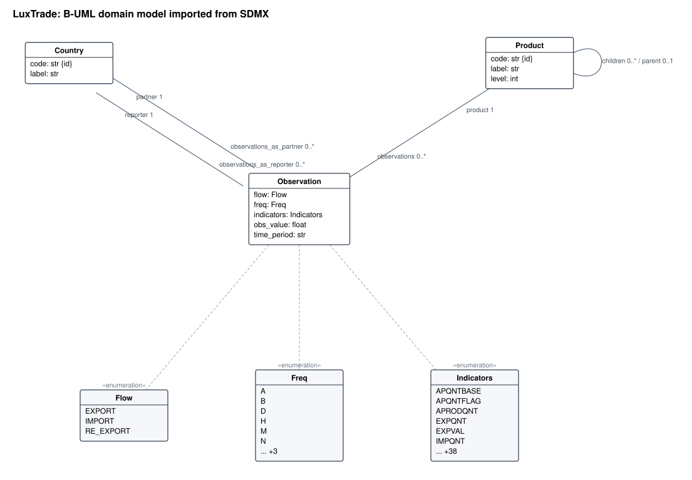
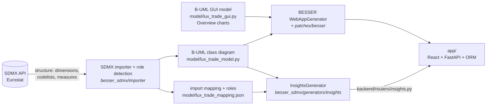
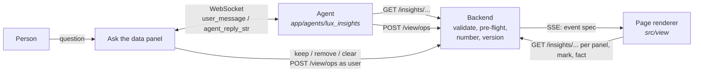
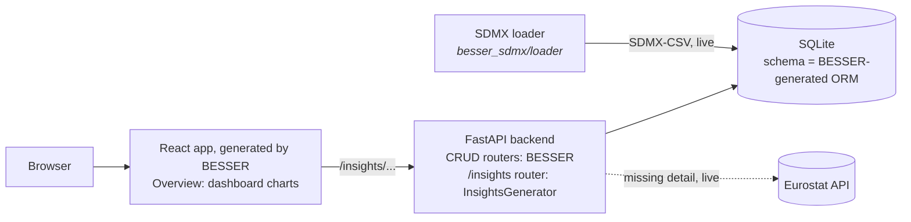

# Architecture

**One idea:** describe the dataset as a BESSER model, and let
[BESSER](https://github.com/BESSER-PEARL/BESSER) generate the application. The class diagram is not
written by hand: it is imported from the dataset's own SDMX structure (Eurostat ds-045409). The
GUI model, one Overview screen, is written by hand. BESSER's existing `WebAppGenerator` builds the
app from both.

*Imported automatically from the SDMX structure of ds-045409 (`model/lux_trade_model.py`).
PlantUML source: [`img/lux_trade_model.puml`](img/lux_trade_model.puml).*

## Build time: from the API to a generated app

`python generate.py` runs the right-hand side: `WebAppGenerator`, then `InsightsGenerator`.

- **Class diagram:** imported, not written (`python -m besser_sdmx import …`).
- **GUI model:** written by hand. The Overview's charts are BESSER dashboard components whose data
  bindings point at analytics URLs (`DataBinding.endpoint`, our BESSER patch).
- **Code:** `app/` was generated by BESSER v8.1.0 (+ our patches) from the models at commit
  `cea06c4`, and is maintained by hand since then (the agent-driven page below). `generate.py` now
  writes to `build/generated/` and refuses to overwrite `app/` without `--force`; CI only checks
  that the models still generate.

## The agent-driven page

The page is drawn from a declarative **view spec** that the backend holds; the browser only renders
it. Agents read numbers from `/insights`, then send typed ops (`POST /view/ops`). The backend
validates the batch against the JSON schemas in [`contract/`](../contract) and the rules in
`app/backend/view/validate.py`, pre-flights every new query against `/insights` (a 4xx or
`loaded: false` rejects the whole batch), numbers the marks, saves a new version
(`data/view_state.json`) and pushes the full spec to every browser over SSE. Panels and marks hold
queries, not data, and text holds `{fact}` placeholders, so every figure on the page is read from
the API. The person at the page keeps or removes marks through the same ops, as agent `user`.

The handbook for agent authors is [agents.md](agents.md).

**The agent** (`app/agents/lux_insights`, ws :8766) speaks the stock BESSER WebSocket protocol
(`user_message` in, `agent_reply_str` out, plus `mode_change` control messages that light up the
working agent's card). It is a BESSER Agentic Framework agent: a router state asks a small fast
model (gpt-4o-mini) for a plan of one to three specialists; each specialist state runs a tool loop
on gpt-6-luna with only its own tools (read: `/insights`, `/trends`; act: `agents/kit` builders),
validates each batch locally with the backend's validator, resolves every `{fact}` before sending,
and has its reply checked so it only types figures its tools returned. It runs in its own
`.venv-agent`.

**The page context.** `spec.context` = `{period, product, flow?}` is the year and the goods the page
shows. The Year and Goods controls send `set_context` as agent `user`; panels written with
`$period`, `$previous` and `$product` follow it; marks name the period they are about, and the page
dims those about another year. The backend pre-flights a batch with the context it will leave.

**The forecast** behind the forecaster's band lives in `app/backend/forecasting` (models, a pooled
gradient boosting model trained on every HS2 chapter, the rolling-origin backtest, conformal bands and
scenarios): [forecasting.md](forecasting.md). One more method, `nn`, is a neural network modelled
in BESSER and generated as PyTorch code: [forecasting_nn.md](forecasting_nn.md).

## Run time: what answers a click

- **Loading:** `python -m besser_sdmx load` downloads the slices in `model/lux_trade_slices.json` live
  from Eurostat into the database whose schema BESSER generated from the class diagram.
- **Clicks:** the app reads the local database. Detail that was not loaded is fetched live from the
  API on demand and recorded in a `_loaded_slice` table, so "not loaded" is never shown as zero.

## What is BESSER, what is ours

| Layer | Existing BESSER | Our patch to BESSER | Our code |
| --- | --- | --- | --- |
| Class diagram | Metamodel, `validate()`, serialisation to `.py` | – | The importer builds it from the SDMX structure: dimensions become enumerations or classes, shared codelists one class, the HS2 → CN8 nomenclature a `parent`/`children` self-association with a `level` |
| GUI model | GUI metamodel: charts, metric cards, data bindings | `DataBinding.endpoint` (a chart reads from any backend URL, not only `/<class>/`) | The Overview model (`model/lux_trade_gui.py`) |
| Backend | `WebAppGenerator`: FastAPI, SQLAlchemy ORM, Pydantic, CRUD routers | Fix for self-associations (`Product.parent`) | `InsightsGenerator`: rankings with the significance ladder, STL seasonal adjustment, movers, revealed comparative advantage, peers |
| Frontend | `WebAppGenerator`: React/Vite app, chart components, pages from the GUI model | – | By hand since `cea06c4`: the view runtime (`src/view`), the crossroads page and the "Ask the data" panel |
| Agents | BESSER Agentic Framework (BAF): states, transitions, LLM wrapper, WebSocket platform | – | The agent on BAF (`app/agents/lux_insights`); `/view` ops, SSE and agent registry (`app/backend/view`, `routers/view.py`), the trend, forecast (`app/backend/forecasting`), events, flows, matrix and tree endpoints, `agents/kit` |
| Neural forecaster | NN metamodel (layers, `Configuration`, `validate()`), `PytorchGenerator` / `TFGenerator`: the network class and a training script for images or a one-target CSV | 0007: an LSTM/GRU returning its last step needs no `input_var`, `train()`/`eval()` modes, multi-target regression | The two B-UML networks (`model/forecast_nn.py`); `TimeSeriesForecasterGenerator` (`besser_sdmx/generators/forecast_nn`): windowing, transforms, seeded training, predict, backtest, CLI; the `nn` method's adapter (`app/backend/forecasting/nn.py`). [forecasting_nn.md](forecasting_nn.md) |
| Data | – (BESSER does not load data) | – | Loader: SDMX-CSV → the generated database |
| Packaging | – | `setup.cfg`: the PyPI wheel of 8.1.0 lacks the React templates | `scripts/setup.*` clone BESSER v8.1.0 and apply [`patches/besser/`](../patches/besser/) |

Earlier experiments built on the same foundations (an interactive explorer component, a generic
`app` command, an export to BESSER's other generators) are kept in the project's Git history; they are not
part of this release.
