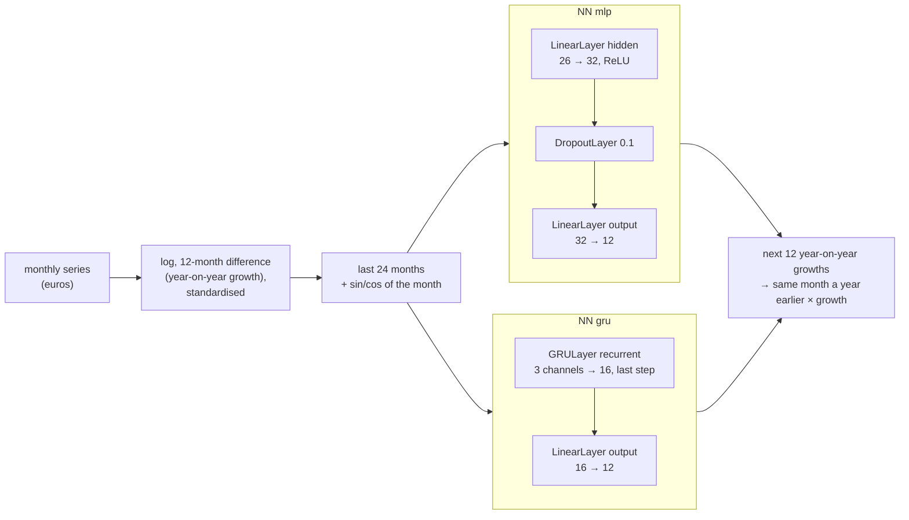

# A neural forecaster modelled in BESSER

The trade forecast (`/insights/forecast`, [forecasting.md](forecasting.md)) has one more method,
`nn`: a neural network that is a **B-UML model** (BESSER's neural-network metamodel), turned into
PyTorch code by a **BESSER generator**. Nothing in the network is hand-written: change the model and
regenerate.

## The model

`model/forecast_nn.py` describes two networks with BESSER's Python API (`NN`, `LinearLayer`,
`DropoutLayer`, `GRULayer`, `Configuration`), checked by BESSER's own `NN.validate()`:



Both use `Configuration(batch_size=32, epochs=60, learning_rate=0.003, optimizer="adamW",
weight_decay=0.01, loss_function="mse")`. The forecasting pipeline (window 24, horizon 12, season 12,
logs, seasonal difference, calendar features, seeds 0, 1, 2 averaged) is a `ForecastConfig` next to
the models.

## What BESSER had, and what we added

**Already in BESSER v8.1.0:** the NN metamodel (linear, convolutional, pooling, recurrent LSTM / GRU /
RNN, dropout, normalisation, embedding and flatten layers, tensor operations, sub-networks, a
training `Configuration`, `Dataset`), its validation, and `PytorchGenerator` / `TFGenerator`, which
write the network class and, when the model has a dataset, a training script. We use them unchanged
for the network: `python model/forecast_nn.py` also writes what the stock generators make of the
two models (`build/nn/stock/`, PyTorch and TensorFlow).

**Gaps for forecasting** (BESSER v8.1.0, `vendor/BESSER`):

| Gap | Where |
|---|---|
| A layer after an LSTM/GRU/RNN with `return_type="last"` or `"full"` needs an `input_var`, though the layer returns one tensor; BESSER's own `tests/BUML/metamodel/nn/lstm.py` fails `validate()` (a known strict-xfail in BESSER's tests) | `besser/BUML/metamodel/nn/neural_network.py:4231` (`_is_multi_output_module`) |
| The generated PyTorch `train()` never calls `model.train()`, `evaluate()` never `model.eval()`: dropout stays on during evaluation (the TF template passes `training=`) | `besser/generators/nn/pytorch/templates/setup_nn_components.py.j2:442`, `:480` |
| Regression labels are always unsqueezed to (batch, 1): a network with several outputs trains on a broadcast loss | same file, `:456`, `:502` |
| Data: a CSV whose last column is the one target, or an image folder; no series, no windowing, no transforms; the file path is fixed at generation time | same file, `:315`–`:330`; `Dataset.input_format` is `csv` or `images` (`neural_network.py:3653`) |
| No seeds: `shuffle=True` without a generator, so two trainings differ | same file, `:335` |
| No prediction function; the model is saved as a pickled object under a timestamped name | same file, `:435` |
| Losses: `mse`, `crossentropy`, `binary_crossentropy` only, so no quantile or MAE loss; regression metrics: MAE only | `neural_network.py:3843`, `:3867` |
| No backtest, no forecast-specific validation (does the first layer read the window? does the last return the horizon?) | – |

**What we added:**

1. **[`patches/besser/0007`](../patches/besser/0007-fix-nn-single-output-recurrent-layers-training-mode-.patch)**,
   generic fixes for the first three gaps, with a BESSER test
   (`tests/generators/nn/test_nn_rnn_outputs_and_training_mode.py`: 8 of its 10 tests fail on 8.1.0,
   all pass with the patch; BESSER's 66 NN tests pass; its `lstm.py` reference model validates
   again, and the strict xfail is removed). Upstream PR: *"fix(nn): single-output recurrent layers,
   training mode and multi-target regression"*, against `development` (see
   [upstream.md](upstream.md), item 7).
2. **A new generator, `TimeSeriesForecasterGenerator`**
   ([`besser_sdmx/generators/forecast_nn/`](../besser_sdmx/generators/forecast_nn)), for the other
   gaps. It subclasses `PytorchGenerator` and reuses its templates for the network, so any layer
   BESSER supports works. Around the network it generates a runnable module
   (`forecaster_<model>.py`) with:
   - windowing (last `window` values in, next `horizon` out, one network for all horizons), as a
     flat vector for an MLP or a (time, channel) sequence for a recurrent first layer;
   - the transforms and their inverse: log, first or seasonal difference, standardisation;
     calendar (sine and cosine of the season position) features;
   - deterministic training: seeds, a seeded shuffle, the global random state left untouched, an
     ensemble of seeds, and a loss masked on the targets not observed yet (so the last year of data
     still trains the network);
   - training on one series or on many at once (a "global" model);
   - `predict` for any number of steps (beyond the horizon the forecasts feed the next window),
     `save` / `load` of the weights only (no timestamps);
   - a rolling-origin `backtest`, `mase` against the seasonal naive forecast, and a command line:
     `python forecaster_mlp.py series.csv --steps 12 --backtest 20`.

   It checks the model before generating: a `Configuration` with the `mse` loss, a first layer that
   reads the window (`LinearLayer` with `window + 2` inputs, or an RNN layer with 3 channels), a
   linear last layer that returns `horizon` values. Nothing in it is about trade; it is proposed
   upstream as `besser/generators/nn/forecaster/` ([upstream.md](upstream.md), item 9).
3. **The adapter** [`app/backend/forecasting/nn.py`](../app/backend/forecasting/nn.py) (~200
   lines, no layer in it): it loads the generated module, feeds it the series already in logs with
   the COVID months cleaned, retrains once a year (on the data up to each December, like the
   gradient boosting model) on every HS2 chapter when the backend has the pool, else on the series
   alone, and caches the trained weights. It registers the method `nn` when torch is installed.

## Generate and run

```bash
pip install torch --index-url https://download.pytorch.org/whl/cpu   # optional: CPU torch, ~200 MB
python model/forecast_nn.py              # validate, generate into build/nn/ (stock + forecasters)
python model/forecast_nn.py --install    # also refresh app/backend/forecasting/generated/
python build/nn/forecaster_mlp.py series.csv --steps 12 --backtest 20
curl "http://localhost:8000/insights/forecast?flow=EXPORT&freq=M&method=nn"
python scripts/backtest_nn.py            # the tables below (minutes; uses data/lux_trade.db)
```

The generated modules are committed in `app/backend/forecasting/generated/` (the backend runs them);
`tests/test_forecast_nn.py` fails if they drift from the model. `FORECAST_NN_NETWORK=gru` switches
the method to the GRU, `FORECAST_NN_ENSEMBLE=1` adds the network to the default ensemble (off: see
below). Without torch, `nn` is not offered and nothing else changes.

Training is on the CPU, three seeds: the MLP takes about 1 second on one series and 5 seconds on the
pool of 190 chapter series, the GRU about 15 and 45 seconds. The weights are cached per December (in
memory and in `FORECAST_CACHE_DIR`), so the backend trains at most once a year per cutoff.

## Backtest

The protocol of [forecasting.md](forecasting.md), unchanged: every quarter end from December 2009
to March 2026 (66 origins), every method trained only on the months up to the origin, forecasting
12 months; the totals of exports and imports against the world (2 series); MASE against the
in-sample seasonal naive error (1.0 = as good as the seasonal naive forecast); the 80% band is
conformal, calibrated only on the errors known at each origin.

| method | MASE 1 month | 3 months | 6 months | 12 months | MASE average | MAPE 1 month | MAPE 12 months | 80% band coverage |
|---|---|---|---|---|---|---|---|---|
| seasonal naive | 1.03 | 0.95 | 0.96 | 0.96 | 0.96 | 10.6% | 9.6% | 82% |
| Holt-Winters | 0.70 | 0.71 | 0.79 | 0.96 | 0.79 | 7.1% | 9.5% | 82% |
| gradient boosting (pooled) | 0.73 | 0.74 | 0.80 | 0.98 | 0.81 | 7.5% | 10.0% | 82% |
| **ensemble (Holt-Winters + gradient boosting), today's default** | **0.68** | **0.68** | **0.77** | **0.93** | **0.76** | **6.9%** | **9.4%** | 82% |
| BESSER MLP, trained on this series only | 0.83 | 0.99 | 1.11 | 1.39 | 1.11 | 8.5% | 14.1% | 88% |
| BESSER GRU, trained on this series only | 0.99 | 1.03 | 1.24 | 1.40 | 1.21 | 10.3% | 14.0% | 80% |
| **BESSER MLP, pooled (the `nn` method)** | 0.80 | 0.80 | 0.86 | 1.02 | 0.85 | 8.4% | 10.5% | 83% |
| BESSER GRU, pooled | 0.86 | 0.81 | 0.87 | 0.98 | 0.89 | 9.0% | 10.1% | 84% |
| Holt-Winters + gradient boosting + BESSER MLP | 0.70 | 0.70 | 0.79 | 0.95 | 0.77 | 7.2% | 9.6% | 83% |

"Pooled" means trained on all 190 HS2 chapter series of exports and imports up to the December before
each origin, like the gradient boosting model. The rows of the existing methods reproduce
[forecasting.md](forecasting.md) to within 0.01, so the harness is the same protocol.

On the 8 largest chapters of each flow (16 series, the last 20 quarter ends, 2021-06 to 2026-03;
`python scripts/backtest_nn.py --chapters 8 --origins 20 --methods snaive,ets,gbm,ensemble,nn_mlp,ensemble_nn`):

| method | MASE 1 month | 3 months | 6 months | 12 months | MASE average | MAPE 1 month | MAPE 12 months | 80% band coverage |
|---|---|---|---|---|---|---|---|---|
| seasonal naive | 1.34 | 1.31 | 1.31 | 1.22 | 1.31 | 16.4% | 16.5% | 86% |
| Holt-Winters | 0.72 | 0.80 | 0.99 | 1.21 | 1.01 | 9.2% | 16.3% | 87% |
| gradient boosting (pooled) | 0.82 | 0.94 | 1.10 | 1.21 | 1.08 | 10.0% | 17.0% | 86% |
| **ensemble (Holt-Winters + gradient boosting), today's default** | **0.73** | **0.82** | **1.01** | **1.19** | **1.01** | **9.0%** | **16.4%** | 86% |
| BESSER MLP, pooled | 0.87 | 1.00 | 1.14 | 1.21 | 1.12 | 11.1% | 16.8% | 86% |
| Holt-Winters + gradient boosting + BESSER MLP | 0.74 | 0.84 | 1.02 | 1.17 | 1.01 | 9.2% | 16.3% | 86% |

## Verdict

- **Feasible, and done:** BESSER's NN metamodel expresses both networks (an MLP and a GRU) without
  workarounds beyond the one patch 0007 removes, its stock generators write correct PyTorch and
  TensorFlow network code, and with our generator the model becomes a deterministic forecaster that
  trains on the CPU in seconds and is served by the backend.
- **The network beats the seasonal naive forecast, but not our classical models.** Pooled on every
  chapter, the MLP is 22% better than the seasonal naive at 1 month and 11% better on average
  (MASE 0.85 against 0.96), but worse than Holt-Winters (0.79), the pooled gradient boosting
  (0.81) and the default ensemble (0.76), and no better than the seasonal naive at 12 months
  (1.02). On the top chapters it is the same story (1.12 against 1.31 and 1.01).
- **Trained on one series, the networks lose to the seasonal naive** (MASE 1.11 and 1.21): about
  300 months is too little for them, as it was for gradient boosting. Pooling is what makes them
  useful. The GRU is no better than the MLP and ten times slower to train, so `nn` uses the MLP.
- **As a third member of the ensemble it does not help** (0.77 against 0.76 on the totals, 1.01 for
  both on the chapters): it makes the same kind of errors as the gradient boosting model, which
  already learns from the same pool with richer features (working days, several growth windows).
  So the default stays Holt-Winters + gradient boosting; `FORECAST_NN_ENSEMBLE=1` exists for
  experiments only.
- **Recommendation:** merge it as a selectable, honestly labelled method (`method=nn`, its backtest
  is in every response's `backtest.methods`), and keep the default. What it shows is that the
  forecasting model, like the class diagram, the app and the agents, can be a BESSER model.
  Better networks are a model change away (more inputs such as working days, a quantile loss for
  the bands); the generator and the backtest are in place to test them.
